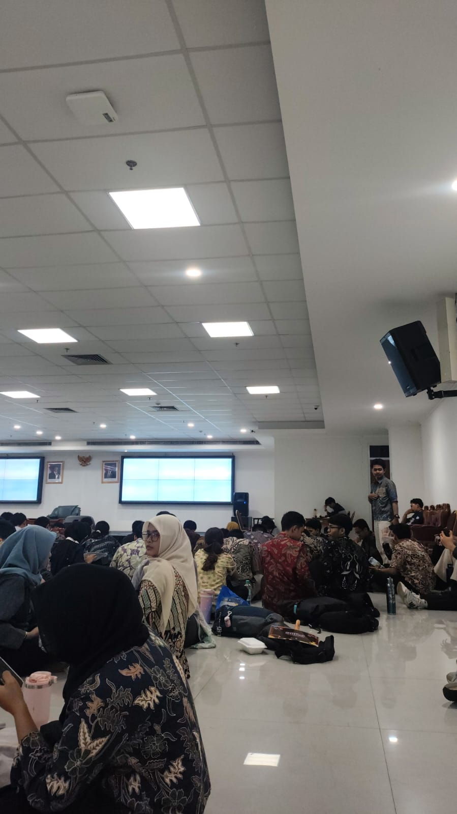
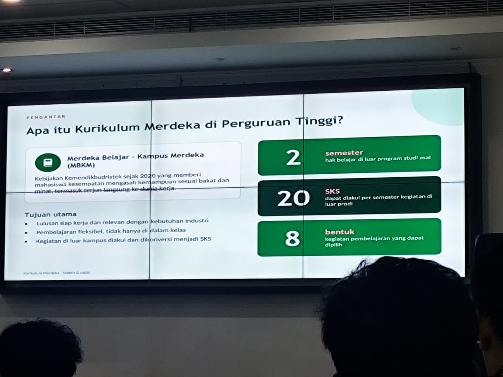
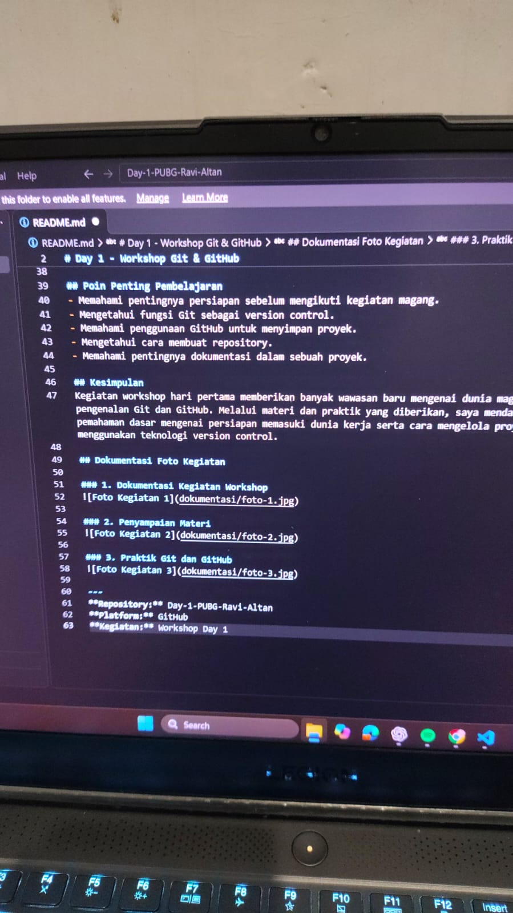

# Day-1-PUBG-Ravi-Altan
# Day 1 - Workshop Git & GitHub
**Dokumentasi Kegiatan Workshop Hari Pertama**

## Identitas Peserta
- **Nama:** Ravi Altan
- **Institusi:** Politeknik Negeri Jakarta
- **Program Studi:** Teknik Multimedia dan Jaringan

## Deskripsi Repository
Repository ini dibuat sebagai media dokumentasi kegiatan workshop hari pertama. Berisi rangkuman materi, catatan pembelajaran, serta dokumentasi foto selama kegiatan berlangsung.

## Tujuan
1. Mendokumentasikan seluruh kegiatan workshop.
2. Menambah wawasan mengenai dunia magang dan persiapan memasuki dunia kerja.
3. Memahami penggunaan Git dan GitHub.
4. Mempelajari cara mengelola dan menyimpan proyek secara online.
5. Menjadikan hasil workshop sebagai referensi pembelajaran.

## Materi Kegiatan

### 1. Pengenalan Dunia Magang
Materi membahas mengenai dunia magang, persiapan sebelum memasuki lingkungan kerja, pentingnya pengalaman industri, serta keterampilan yang perlu dikembangkan untuk menghadapi dunia profesional.

### 2. Pengenalan Git
Git merupakan sistem version control yang digunakan untuk mencatat dan mengelola perubahan pada file atau proyek. Dengan Git, pengguna dapat mengetahui riwayat perubahan dan mengelola versi proyek.

### 3. Pengenalan GitHub
GitHub merupakan platform berbasis online yang digunakan untuk menyimpan repository, mengelola proyek, serta berkolaborasi dengan pengguna lain.

### 4. Praktik Git dan GitHub
Dalam kegiatan ini, peserta mempraktikkan beberapa hal, yaitu:
- Membuat akun GitHub.
- Membuat repository baru.
- Mengatur repository menjadi Public.
- Membuat dan mengedit file README.md.
- Mengenal proses penyimpanan dan pengelolaan dokumentasi.

## Poin Penting Pembelajaran
- Memahami pentingnya persiapan sebelum mengikuti kegiatan magang.
- Mengetahui fungsi Git sebagai version control.
- Memahami penggunaan GitHub untuk menyimpan proyek.
- Mengetahui cara membuat repository.
- Memahami pentingnya dokumentasi dalam sebuah proyek.

## Kesimpulan
Kegiatan workshop hari pertama memberikan banyak wawasan baru mengenai dunia magang serta pengenalan Git dan GitHub. Melalui materi dan praktik yang diberikan, saya mendapatkan pemahaman dasar mengenai persiapan memasuki dunia kerja serta cara mengelola proyek menggunakan teknologi version control.

## Dokumentasi Foto Kegiatan

### Foto 1

### Foto 2

### Foto 3

---
**Repository:** Day-1-PUBG-Ravi-Altan  
**Platform:** GitHub  
**Kegiatan:** Workshop Day 1